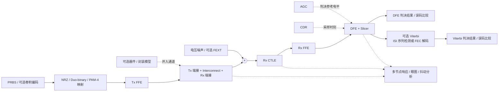

# PyBERT 信号链、模块设置与参数

研究日期：2026-10-23。研究对象为当前工作区对应的 **PyBERT 11.1.0**，固定提交 `1bc905d577d2f3bd9471421cfbf3d422d4e6080e`；下文源码链接均指向官方仓库这一提交。版本号来自 [`pyproject.toml`][version]。官方 [Read the Docs 的 latest 页面](https://pybert.readthedocs.io/en/latest/intro.html)在本次查询时仍显示 v10.1.0，因此参数、默认值和实际执行路径以当前源码为准。

本文覆盖 PyBERT 主 GUI 的信号链设置、相关配置/API 选项、优化器和结果分析。外部 IBIS-AMI 模型的 `Model_Specific` 参数、外部 COM 配置表的全部字段由具体模型/配置决定，不存在一份适用于所有模型的固定 PyBERT 参数表。本研究进行了源码与 GUI 声明交叉核对，未运行链路仿真；静态发现的实现限制单独列出。

配套[交互式信号链配置工具](pybert-signal-chain-ui/index.html)可在本地浏览器直接打开。点击 stage 编辑本地参数草稿，或查看默认值、范围、生效条件和源码映射；Native / AMI 方案同步到图示，不接入计算功能，也不写入 PyBERT 配置。

2026-10-24 补充[从原 GUI 反查的覆盖核对](pybert-signal-chain-ui/gui-audit.zh-CN.md)：登记 129 个主窗口命名控件，修复编辑条件与表格缺列，并明确模型动态对话框、结果和原生菜单仍未接入的范围。

## 1. 信号链总览

**Native 主链可概括为：PRBS → 调制映射 → Tx FFE → 含 Tx/Rx 端接的通道 → 接收侧电压噪声 → CTLE → Rx FFE → DFE/CDR/判决 → 误码比较；Viterbi 是可选的后处理判决路径。** 实际入口是 `PyBERT.simulate()`，主流程位于 `models/bert.py::my_run_simulation()`。[主流程][pipeline]、[Native Tx/Rx 路径][native_path]、[Rx FFE 与 DFE/CDR][rx_path]

需要同时区分四类对象：

| 类别 | 内容 | 在 PyBERT 中的位置 |
|---|---|---|
| 信号链 | Tx、通道、CTLE、FFE、DFE、CDR、判决器 | 逐样本波形或脉冲响应处理 |
| 替代实现 | IBIS 模型、AMI Init/GetWave、外部 CTLE 文件 | 替换部分 Native 模型；不是固定追加全部模块 |
| 参数搜索 | Optimizer，包含 MMSE 或 AMI 参数搜索 | 在正式时域仿真之外选择均衡设置 |
| 结果与独立分析 | BER 计数、眼图、jitter、bathtub、COM | 测量主链结果，或另行执行 COM 评估 |

这里没有独立的多位 ADC/量化器配置，也没有完整模拟 VGA 模块。`nspui` 是仿真时间网格密度，`Use AGC` 调整的是判决参考 `decision_scaler`。源码中的 `chnl_out` 是“只有通道、没有 Tx EQ”的对照输出；实际 Native Rx 输入是 Tx FFE 与通道共同作用后的 `rx_in`，不能把两个输出当成前后串接的两个通道。[对照通道输出][channel_reference]、[DFE/AGC 实现][dfe_model]

## 2. 参数表的读法

- **默认值**指新建实例的参数初值，尚未加载用户配置或应用仿真自适应结果；正常 GUI 构造时会自动运行一次仿真，Level 等值可能随后被 AGC 更新。Rx FFE 初始化会重排 tap，已单独说明。[构造过程][init_ffe]
- **无显式范围**指 Traits 使用 `Float`/`Int` 而没有设置上下限，不能理解为任意数值都有物理意义或一定可运行。
- tap 的 `min_val/max_val` 是优化/自适应所用约束，不是 `Float` 输入框自身的统一硬校验。
- 除标为“API/配置”或“内部状态”的字段外，下面的主要设置均可在 GUI 对应页找到。默认值的主要来源是 [`PyBERT` 参数声明][traits]，GUI 可见性与标签来源是 [`view.py`][view]。

## 3. 仿真控制与激励源

GUI：`Config. → Simulation Control`；对应声明见 [simulation traits][sim_traits]，显示条件见 [Simulation Control UI][sim_ui]。

| GUI 设置 / Python 参数 | 默认 | 单位 / 可选值 / 显式范围 | 作用 |
|---|---|---|---|
| Bit Rate / `bit_rate` | 10.0 | Gbps；0.1–250.0 | 比特率；普通 PAM-4 的符号率为比特率的一半 |
| Samps. per UI / `nspui` | 32 | samples/UI；2–256 | 每个符号周期的波形采样数 |
| Modulation / `mod_type` | `NRZ` | `NRZ`、`Duo-binary`、`PAM-4` | 调制/线码选择 |
| RLM / `rlm` | 0.95 | 无量纲；无显式范围 | PAM-4 时可编辑；当前只传入 MMSE 优化器，不修改时域映射电平 |
| Pattern / `pattern` | `PRBS-7` | PRBS-7/9/11/13/15/20/23/31 | LFSR 测试序列 |
| Seed / `seed` | 1 | 整数；0 表示每次重新随机取种子 | 非零种子同时用于 PRBS 与随机噪声的可重复生成 |
| Nbits / `nbits` | 15000 | bit；1000–10000000 | 生成的测试比特数 |
| EyeBits / `eye_bits` | 10160 | bit；无显式上下限 | 末段眼图/分析窗口；误码比较也使用末段 `eye_bits` |
| Vod / `vod` | 1.0 | V；无显式范围 | 符号电压缩放；之后的通道还包含端接分压 |
| Rn / `rn` | 0.01 | V RMS；无显式范围 | Gaussian 电压噪声标准差 |
| Pn / `pn_mag` | 0.01 | V；无显式范围 | 周期电压噪声源幅度 |
| f(Pn) / `pn_freq` | 11 | MHz；无显式范围 | 周期电压噪声频率 |
| Debug / `debug` | `False` | bool | 额外调试日志；不是信号处理模块 |

普通 PAM-4 以两个比特生成一个 Gray 编码符号，归一化电平为 `-1, -1/3, +1/3, +1`，再乘 `vod`。NRZ 使用二电平；Duo-binary 先 XOR 预编码，再依靠系统响应形成三电平波形。`ui`、`nui`、`eye_uis` 是派生值：由于 `bit_rate` 的输入单位为 Gbps，普通 PAM-4 的 UI 为 `2/(bit_rate × 10^9)` 秒，UI 数为比特数的一半；启用内置 FEC 的特殊 PAM-4 路径采用不同换算。[映射和 UI][mapping]、[Duo-binary 参考波形][channel_reference]

`Pn` 不是正弦相位抖动设置：代码生成矩形波，再通过固定 1 MHz 截止频率的二阶高通来模拟电容耦合，之后叠加 Gaussian 噪声。在全 Native 主链中，噪声加入 `rx_in`，即 Tx FFE/通道之后、CTLE 之前；GUI 将它们放在 `Tx Level & Noise` 组并不代表噪声一定在 Tx 输出端注入。[高通常量][noise_constant]、[噪声生成][noise]、[Native 注入位置][native_path]

## 4. Tx：电气模型与发送均衡

Tx 有两个独立选择器：`Config. → Channel → Tx` 的 `tx_sel` 选择电气参数来源；`Equalization → Tx Equalization` 的 `tx_eq_sel` 选择均衡实现。IBIS 电气模型可以与 Native EQ 配合，不能把选择 IBIS 文件等同于启用 AMI。[Tx/Rx traits][txrx_traits]、[模式切换][mode_switch]

| 设置 / 参数 | 默认 | 单位 / 可选值 / 范围 | 说明 |
|---|---|---|---|
| `tx_sel` | `native` | `native` / `ibis` | Native 阻抗/电容或 IBIS 提取值 |
| Tx_Rs / `rs` | 100 | Ω，差分；无显式范围 | Tx 源端阻抗 |
| Tx_Cout / `cout` | 0.5 | pF；0.001–1000 | GUI 定义为每 pin 寄生电容 |
| File / `tx_ibis_file` | 空 | `.ibs` 文件 | Select 选择模型，View 查看模型 |
| Use on-die S-parameters / `tx_use_ts4` | `False` | bool | 模型包含 `Ts4file` 时可用 |
| `tx_eq_sel` | `Native` | `Native` / `IBIS-AMI` | Tx EQ 实现 |
| `tx_taps` | 见下表 | 每 tap 的 `enabled/value` | Native Tx FIR 系数 |

Native Tx 提供三个前游标、三个后游标设置；主游标不单独编辑，而按 `1 − Σ|非主游标 tap|` 计算。主链中相邻 tap 间隔 1 UI。初始所有非主游标权重为 0，因此尽管 Pre-tap2 和 Pre-tap1 默认启用，初始并没有实际预加重。[Tx 默认 tap][tx_taps]、[Tx 主游标计算][tx_cursor]

| Tap | 位置（UI） | 默认启用 | 默认权重 | 默认优化范围 | 默认搜索步长 |
|---|---:|---|---:|---|---:|
| Pre-tap3 | -3 | 否 | 0 | -0.05–0.05 | 0.025 |
| Pre-tap2 | -2 | 是 | 0 | -0.10–0.10 | 0.05 |
| Pre-tap1 | -1 | 是 | 0 | -0.20–0.20 | 0.10 |
| Post-tap1 | +1 | 否 | 0 | -0.20–0.20 | 0.10 |
| Post-tap2 | +2 | 否 | 0 | -0.10–0.10 | 0.05 |
| Post-tap3 | +3 | 否 | 0 | -0.05–0.05 | 0.025 |

表中搜索步长来自 `tx_tap_tuners`，用于 `Optimizer`；实际 `tx_taps` 与优化器表是两组对象。`tx_c0_min=0.0` 是 API/配置项，限制优化器允许的最小主游标；优化器另外排除主游标 ≤0 的候选，不能把这一保护推广为所有手动 tap 输入都已受检。[优化器默认值][opt_traits]、[Tx 候选约束][opt_tx]

## 5. Interconnect：原生通道、文件和多 lane

GUI：`Config. → Channel → Interconnect`。主选择器 `inter_sel` 默认 `native`，可选 `native/single/multiple`；只有对应模式下的文件字段才会被读取。[通道声明][channel_traits]、[通道执行][channel_build]、[通道 UI][channel_ui]

### 5.1 Native 通道

Native 使用 Howard Johnson UTP 参数化损耗通道，参数如下。`Rdc`、`R0` 的实际单位是 Ω/m；GUI 简写为 Ohms，但模型文档与计算均按单位长度电阻定义。[通道模型][channel_math]

| GUI / 参数 | 默认 | 单位 | 含义 / 范围 |
|---|---:|---|---|
| Length / `l_ch` | 0.5 | m | 长度；无显式范围 |
| Loss Tan. / `Theta0` | 0.02 | 无量纲 | 介质损耗角正切；无显式范围 |
| Z0 / `Z0` | 100 | Ω | LC 区差分特性阻抗；无显式范围 |
| v_rel / `v0` | 0.67 | 相对光速 c | 传播速度；无显式范围 |
| Rdc / `Rdc` | 0.1876 | Ω/m | 直流电阻；无显式范围 |
| w0 / `w0` | 10000000 | rad/s | 模型过渡角频率；不是 10 MHz 的频率值 |
| R0 / `R0` | 1.452 | Ω/m | 趋肤效应电阻参数；无显式范围 |

### 5.2 文件、串接和 FEXT

| 设置 / 参数 | 默认 | 可选值 / 条件 | 作用 |
|---|---|---|---|
| Single File / `ch_file` | 空 | `inter_sel='single'` | 一个通道文件 |
| Multiple Files / `ch_files` | 空列表 | `inter_sel='multiple'` | 按列表顺序逐段 cascade，并非并行仿真多条链路 |
| Fix port numbering / `renumber` | `False` | bool；非 Native 时可编辑 | 检测/修正 4-port through-path 端口约定 |
| Apply window / `use_window` | `False` | bool；GUI 非 Native 时可编辑 | IFFT 前给频率响应加 raised-cosine 窗 |
| Victim Lane / `lane_sel` | 0 | 0 起算；`.s8p` 为 0–1，`.s12p` 为 0–2 | 选择受害通道；越界由导入函数拒绝 |
| Include FEXT / `include_fext` | `False` | GUI：single 且 `.s8p/.s12p` | 从其他 lane 提取串扰路径并加入噪声 |

Single File GUI 列出 `.s2p/.s4p/.s8p/.s12p/.csv/.txt`；底层 `import_freq()` 另支持 1-port Touchstone。时域文件读取前两列数值，第一列时间、第二列波形，再重采样。Multiple Files GUI 限定 single-ended `.s4p`，运行时用网络级 cascade 运算串接。[文件 UI][channel_ui]、[导入函数][sparam_import]、[时域读取][time_import]

当前多 lane 功能是**选择一个 victim，加其他 lane 的 FEXT**，不是为每个 lane 建立独立 Tx/Rx/CDR。所有 aggressor 在主仿真中使用与 victim 相同的 `x` 波形；源码称其为 coherent worst case，不应理解成独立随机 PRBS。AMI 初始化时也可收到 FEXT 响应矩阵。[FEXT 提取与注入][fext]、[噪声循环][noise]、[AMI FEXT 输入][ami_api]

底层 `import_channel/import_freq` 另有 `vita_end='tx'/'rx'`，用于 VITA 68.x 的每 lane 8-port 约定；这不是当前 GUI 设置，主 `calc_chnl_h()` 的 multiple 分支也没有传递 `vita_end`。不能把底层 API 能力直接当作 GUI 已支持自动 VITA 段提取。[VITA 导入][sparam_import]、[主链文件调用][channel_build]

### 5.3 仿真与响应网格

GUI：`Config. → Analysis Parameters`；这些设置同时影响响应构建，而不只是显示。[Analysis UI][sim_ui]、[通道频域到时域][channel_response]

| 参数 | 默认 | 单位 / 范围 | 作用 |
|---|---:|---|---|
| `f_max` | 40 | GHz；无静态上下限 | 最大建模/绘图频率；修改时会被限制在当前采样 Nyquist 频率以内 |
| `f_step` | 10 | MHz；无显式范围 | 频率网格步长 |
| `impulse_length` | 0 | GUI 单位 ns | 0 自动裁剪；非零手动覆盖响应长度，当前 CTLE 路径存在单位不一致，见末节 |
| `thresh` | 3.0 | sigma；无显式范围 | `Pj Threshold`，用于 jitter 频谱中的周期分量识别 |

通道自动响应裁剪使用 20–100 UI 的长度边界与 0.999 保留能量参数；不是对任意长延迟/反射都无限保留。`f_max` 变化处理见 [`_f_max_changed()`][freq_guard]。

## 6. Rx 端接与可选封装模型

GUI：`Config. → Channel → Rx`，以及 Interconnect 内的 `Tx/Rx Device Models`。封装路径选择 P802.3dj/D3.3 Annex 178A 的 Tx/Rx 器件模型预设，而不是新增另一个 EQ。[器件参数声明][device_traits]、[封装网络实现][pkg_path]、[器件模型 UI][device_ui]

| 设置 / 参数 | 默认 | 单位 / 可选值 / 范围 | 作用 |
|---|---|---|---|
| `rx_sel` | `native` | `native` / `ibis` | Rx 电气参数来源 |
| Rx_Rin / `rin` | 100 | Ω，差分；无显式范围 | Rx 输入阻抗 |
| Rx_Cin / `cin` | 0.5 | pF；无显式范围 | GUI 定义为每 pin 寄生电容 |
| Rx_Cac / `cac` | 1.0 | μF；无显式范围 | GUI/配置存在；当前主链没有实际使用，见末节 |
| `rx_ibis_file` | 空 | `.ibs` 文件 | 选择/查看 Rx IBIS 模型 |
| `rx_use_ts4` | `False` | bool | 模型有 Ts4file 时使用 on-die S-parameters |
| Enable / `pkg_enable` | `False` | bool | 用器件端接/封装/可选 partial host 模型替换 lumped Rs/Cout、Rin/Cin 路径 |
| Group / `pkg_group` | `KR` | `KR` / `C2C` / `CR` / `C2M` | 选择预设族 |
| Tx case / `tx_pkg_case` | `A1` | 字符串；有效选项取决于 Group | KR/C2C：A1/A2/B1/B2；CR：HL/HN/HH；C2M：host/module |
| Rx case / `rx_pkg_case` | `A1` | 同上 | Rx 对应预设 |
| Partial host / `pkg_include_host` | `True` | bool | 在适用预设中包含 partial host PCB |

启用 `pkg_enable` 后，主链使用 `Tx device ** channel ** Rx device` 再端接，输入是加 on-die S-parameters **之前**的通道网络。GUI 提示该功能面向 Native Tx/Rx；因此不要把它理解成同时叠加 IBIS on-die 模型和 Native lumped 端接。若输入通道已包含 host PCB，`Partial host` 会影响是否重复纳入同一段。[封装主调用][channel_response]、[预设说明][device_ui]

## 7. Rx CTLE 与 Rx FFE

### 7.1 CTLE

GUI：`Equalization → Rx Equalization → Native → CTLE`。先由 `rx_eq_sel` 选择 `Native` 或 `IBIS-AMI`；Native CTLE 下再选择解析模型或文件。[CTLE traits][device_traits]、[CTLE UI][eq_ui]、[CTLE 执行][ctle_path]

| GUI / 参数 | 默认 | 单位 / 可选值 / 范围 | 含义 |
|---|---|---|---|
| `rx_eq_sel` | `Native` | `Native` / `IBIS-AMI` | Rx EQ 实现 |
| Enable / `ctle_enable` | `True` | bool | 使能 Native CTLE |
| `ctle_sel` | `Native` | `Native` / `File` | 解析模型或导入响应 |
| Filename / `ctle_file` | 空 | GUI 过滤 `.csv` | 外部 CTLE 响应；当前实现有已标注 FIXME |
| CTLE fp / `peak_freq` | 5.0 | GHz；无显式范围 | CTLE peaking 参数频率 |
| Bandwidth / `rx_bw` | 12.0 | GHz；无显式范围 | 未均衡信号路径的带宽参数 |
| CTLE boost / `peak_mag` | 1.7 | dB；无显式范围 | 相对 peaking 幅度参数 |
| `use_ctle_file` | `False` | 内部 bool | 由 `ctle_sel='File'` 同步设置，不是另一个独立 GUI 开关 |

解析 CTLE 是一零点、二极点模型，极点由 `peak_freq/rx_bw` 决定，零点由 `peak_mag` 决定；频率响应按最大幅度归一化。因此 `boost` 表示响应形状的相对提升，不是一个另外独立的宽带线性电压增益旋钮。全 Native 路径中 `ctle_enable=False` 会直接令 `ctle_out=rx_in`，绕过这一 CTLE 模型。[CTLE 公式实现][ctle_math]、[旁路分支][native_path]

### 7.2 Rx FFE

GUI：`Equalization → Rx Equalization → Native → FFE`。Native Rx FFE 是固定 FIR，仿真中不会自行 LMS 训练；需要手工填写权重，或先 Optimize EQ 再 Use EQ。它只在 `not rx_use_ami` 时作用。[FFE 执行][rx_path]、[Use EQ][eq_commit]

| GUI / 参数 | 初始化后的默认 | 范围 / 作用 |
|---|---|---|
| Ntaps / `rx_n_taps` | 15 | `Int`；负值改为 0。内部预建 100 个 tap，未给出对应的严格上限校验 |
| Npre / `rx_n_pre` | 5 | `Int`；主游标之前的 tap 数。类声明为 4，但 `__init__` 立即改为 5 |
| tap `enabled` | 前 15 项启用 | `Ntaps/Npre` 变动会重排/更新 tap 状态；Equalization 表也可逐项勾选 |
| tap `value` | 只有一个 tap 为 1，其余为 0 | 无量纲 FIR 权重；默认相当于纯延时，没有实质均衡 |
| tap `min_val/max_val` | -1.0 / +1.0 | Optimizer 中的权重约束；不是 Native 运行时自动裁剪 |
| tap `step` | 0.1 | Optimizer 非 MMSE 搜索步长 |

需要特别保留这个当前版本细节：工厂初始 unity 位于列表 index 1；构造函数把 `Npre` 从 4 改为 5 时只右移一项，初始化后 unity 位于 index 2、标签为 `Pre-tap3`，而不是标为 `Cursor` 的 index 5。这里是静态顺序推导，未实例化运行；无论其标签，只有一个非零 tap 的滤波器均没有消除 ISI 的作用。实际主链直接取 `rx_taps`，不调用另一个 `rx_ffe` 属性所含的隐式 cursor 计算。[FFE 工厂][ffe_factory]、[初始化][init_ffe]、[重排回调][ffe_observer]、[实际 FIR 构建][rx_path]

## 8. DFE、CDR、Slicer 与 AGC

这些模块在实现上紧密耦合：DFE 的 `run_dfe()` 负责采样时刻、判决、反馈、自适应和 Level 调整；CDR 不是主链末端的额外滤波器。[DFE 模型][dfe_model]、[主链 DFE/CDR 调用][dfe_path]

### 8.1 DFE / Slicer

GUI：`Equalization → Rx Equalization → Native → DFE`；tap 数与约束在 `Optimizer → Rx DFE` 配置。[DFE traits][dfe_traits]、[DFE UI][dfe_ui]

| 设置 / 参数 | 默认 | 单位 / 范围 | 作用 |
|---|---:|---|---|
| Gain / `gain` | 0.1 | 无量纲；无显式范围 | decision-directed 自适应误差反馈增益 |
| Nave. / `n_ave` | 100 | 时钟/采样周期计数；trait 为 Float，无显式范围 | tap 修正的平均/更新间隔；自适应在 CDR 锁定后进行 |
| Level / `decision_scaler` | 0.5 | V；无显式范围 | 判决输出标度与判决阈值参考 |
| Use AGC / `use_agc` | `True` | bool | 按采样电平持续更新 Level；不是改变输入波形的模拟增益级 |
| Ideal / `sum_ideal` | `True` | bool | 理想无限带宽求和节点 |
| Bandwidth / `sum_bw` | 12.0 | GHz；无显式范围 | `sum_ideal=False` 时的求和节点低通带宽 |

DFE 可配置 20 个 tap，默认 Tap1–5 启用、Tap6–20 禁用，初始权重为 0。**实际执行只使用从 Tap1 起连续启用的前缀**：遇到第一个禁用 tap 就停止收集，不能用中间留空的勾选方式表达 sparse/floating DFE。[tap 默认值][dfe_taps]、[连续前缀取值][dfe_path]

| Tap | 默认约束 min/max | 初始权重 | 说明 |
|---|---|---:|---|
| Tap1 | -0.20 / +0.40 | 0 | Mueller-Muller 模式可按预估 post-cursor 初始化 Tap1 |
| Tap2 | -0.15 / +0.15 | 0 | 默认启用 |
| Tap3–5 | -0.05 / +0.10 | 0 | 默认启用 |
| Tap6–20 | -0.05 / +0.10 | 0 | 默认禁用 |

优化器显示的 DFE `value` 是优化计算结果，不等于下一次仿真直接加载的初始权重；时域仿真通常重新从 0 自适应，MM 模式的 Tap1 是例外。没有启用 DFE tap 时仍需要判决/CDR 功能，所以会创建没有反馈 tap 的 dummy DFE。[DFE 初始化][dfe_model]、[dummy DFE 与 MM 初始化][dfe_path]

### 8.2 CDR

GUI：`Equalization → Rx Equalization → Native → CDR`。[CDR traits][dfe_traits]、[CDR UI][eq_ui]

| 设置 / 参数 | 默认 | 单位 / 可选值 / 范围 | 作用 |
|---|---:|---|---|
| Type / `cdr_type` | `Bang-Bang` | `Bang-Bang` / `Mueller-Muller` | 动态 bang-bang 恢复或固定 MM 锁定相位 |
| Delta-t / `delta_t_ui` | 0.001 | UI；无显式范围 | Bang-Bang 比例分支修正步长，运行时乘 UI 转为秒 |
| Alpha / `alpha` | 0.01 | 无量纲；无显式范围 | 相对积分分支强度 |
| Lock Nave. / `n_lock_ave` | 500 | UI 估计数量；无显式范围 | 锁定判定窗口 |
| Lock Tol. / `rel_lock_tol` | 0.1 | 相对量；无显式范围 | 锁定判定容差 |
| Lock Sus. / `lock_sustain` | 500 | 判定历史长度；无显式范围 | 锁定状态迟滞 |

Mueller-Muller 模式根据 slicer 输入脉冲响应和 DFE Tap1 限制求固定相位，之后按标称 UI 采样、从开始就视为 locked；它模拟锁定点，**没有仿真动态 Mueller-Muller 环路的捕获和跟踪过程**。这时 GUI 禁用下方 Bang-Bang 参数。[MM 分支][dfe_path]、[固定时钟执行][dfe_model]

## 9. IBIS-AMI 替代路径

IBIS 电气模型与 AMI 算法模型分开选择。有效 `.ibs` 模型解析后关联 `.ami` 和 DLL/SO；`.ami` 文件规定模型特有参数，`Configure` 打开模型参数配置。选择 `IBIS-AMI` 需要对应 IBIS、AMI 和动态库有效。[模式选择][mode_switch]、[AMI 解析][ami_parse]、[AMI GUI][ami_ui]

| 设置 / 参数 | 默认 | 条件 / 说明 |
|---|---|---|
| `tx_ami_file` / `rx_ami_file` | 空 | GUI 只读展示；由所选 IBIS 模型关联 |
| `tx_dll_file` / `rx_dll_file` | 空 | GUI 只读展示；平台匹配的 `.dll/.so` |
| Use GetWave / `tx_use_getwave` | `False` | 需模型声明 `GetWave_Exists`；若 Init 不返回脉冲响应，解析时自动置 True |
| Use GetWave / `rx_use_getwave` | `False` | 同上 |
| Use Clocks / `rx_use_clocks` | `False` | Rx GetWave 模式下可编辑；尝试使用模型返回的 clock times |
| `tx_use_ami` / `rx_use_ami` | `False` | 内部生效状态，由 EQ 选择器/解析过程维护；不应代替模式选择器 |
| `*_ibis_valid` / `*_ami_valid` / `*_dll_valid` | `False` | Valid 状态灯；不是可编辑信号参数 |
| `*_has_getwave` / `*_has_ts4` | `False` | 从文件能力声明得出的状态 |
| Model_Specific 参数 | 由模型决定 | 类型、名称、默认、范围取自具体 `.ami`；没有通用固定清单 |

AMI Init 路径用模型返回脉冲响应做卷积；GetWave 路径把时域波形交给动态库处理。PyBERT 显式处理 Tx/Rx 的不同组合，不能把所有组合都画成相同的 Native 模块串联。[AMI API][ami_api]、[组合执行路径][ami_paths]

当前可确定的生效条件：

- Rx AMI 生效时，Native Rx FFE 在仿真中被旁路，实际 `rx_taps` 保留。切换 observer 禁用的是 DFE 表 `dfe_tap_tuners` 和 FFE 搜索表 `ffe_tap_tuners`，保留需要的 dummy CDR/判决功能；本地 WebUI 草稿保留 Native 参数，不执行此 observer。
- **Rx AMI + GetWave + Use Clocks + 实际返回有效时钟**同时成立时，代码直接按模型时钟采样，跳过原生 `run_dfe()` 循环；仍使用判决器把电压变为比特。
- 如果未取得有效 AMI clocks，原生 CDR 仍会参与；用户若在切换 AMI 后重新启用 DFE taps，运行分支也可能使用原生 DFE 反馈。这不是正常切换 AMI 后的默认叠加行为。
- Native/Init Tx 配合 Rx Init 时，显式噪声在 Rx AMI 输出后加入；配合 Rx GetWave 时，噪声随 `rx_in` 输入模型。Tx GetWave 分支虽然计算了含噪声的 `rx_in`，但各下游接收分支未使用这一含噪声输入。
- Tx/Rx 均为 GetWave 时，当前调用丢弃了 Rx 返回的 clocks，因此 `Use Clocks` 不能单独保证进入模型时钟分支。WebUI 对噪声位置及这一时钟限制分别标注。[Rx FFE 条件][rx_path]、[Rx AMI observer][ami_parse]、[AMI clocks 条件][dfe_path]、[AMI 组合代码][ami_paths]

以仓库自带的 `models/ibisami/example_rx.ami` 为例，其 `Model_Specific` 设置如下。**这张表只适用于该示例 Rx 模型**，名称、范围与 Native PyBERT 参数分开解释；这里只读取模型声明，没有执行动态库。[示例 AMI 定义][ami_example]

| 示例 AMI 参数 | 初值 | 可选值 / 范围 / 单位 |
|---|---:|---|
| `ctle_mode` | 0 | 0=Off，1=Manual |
| `ctle_freq` | 5e9 | 1e9–5e9 Hz；即 1–5 GHz |
| `ctle_mag` | 0 | 0–12 dB |
| `ctle_bandwidth` | 12e9 | 5e9–50e9 Hz；即 5–50 GHz |
| `ctle_dcgain` | 0 | -20–20 dB |
| `dfe_mode` | 0 | 0=Off，1=Manual，2=Adaptive |
| `dfe_ntaps` | 5 | 整数；模型文件未声明数值范围 |
| `dfe_tap1`–`dfe_tap5` | 均为 0 | 初始 tap 权重；模型文件未声明数值范围 |
| `dfe_vout` | 1.0 | 0–1 V；判决输出幅度 |
| `dfe_gain` | 0.1 | 0–1；误差反馈增益 |
| `debug.dbg_enable` | `False` | bool；模型调试总开关 |
| `debug.dump_dfe_adaptation` | `False` | bool；导出自适应数据 |
| `debug.dump_adaptation_input` | `False` | bool；导出 DFE 求和节点输入 |

该模型还以 `Reserved_Parameters` 声明 `AMI_Version=5.1`、`Init_Returns_Impulse=True`、`GetWave_Exists=True`。这些是能力/版本信息，用于选择可用调用方式，不是上述均衡输入参数。[模型能力声明][ami_example_info]

## 10. Viterbi / MLSD 与内置 FEC

GUI：`Config. → Channel → Rx` 的 Native 面板包含 `Use Viterbi`、`Trellis Depth`；`Results → Viterbi` 显示 trellis 和误码位置。它在 DFE/CDR 之后另算一套判决与误码结果，不替换前面所有接收处理。[Viterbi UI][viterbi_ui]、[Viterbi 执行][viterbi_path]

| 参数 | 默认 | 范围 / 作用 |
|---|---:|---|
| `rx_use_viterbi` | `False` | bool；启用可选序列解码 |
| `rx_viterbi_symbols` | 4 | `Int`，无统一显式上下限；ISI 路径中为每个状态包含的符号数 N |
| `rx_viterbi_fec` | `False` | API/内部选项，当前主 GUI 没有对应编辑项；True 时选择 FEC 解码并将调制设为 PAM-4 |
| `trellis_pan_control` | 0 | 0–`trellis_max_x`；绘图位置，不影响链路 |
| `trellis_err_select` | 0 | 0–`trellis_max_err`；跳转误码位置，不影响链路 |

ISI 路径使用恢复时钟采样后的 DFE 输出、同相位脉冲响应和估计电压噪声来定义观察概率。电平数 L 由调制决定，状态数是 `L^N`：默认 N=4 时 NRZ 为 16、PAM-4 为 256。N 同时用于状态中的符号数量和初始 trellis 深度，因此 `Trellis Depth` 不只是一个独立的 traceback 长度旋钮，增加它会增加状态组合和计算量。[ISI decoder][viterbi_model]

FEC 路径是简单 **rate-1/2 卷积编码**：每个输入 bit 生成两个编码 bit，再映射成一个 PAM-4 符号；解码输入为 DFE 已硬判决的 bit pair。编码器有 3 个记忆 bit，生成式在 `FEC_Encoder.step()` 中定义；不是 Ethernet RS-FEC，也没有 GUI 可配置的 RS 码长、纠错符号数、交织深度。`FEC_Decoder` 构造函数要求 trellis depth ≥2。[FEC 编解码器][fec_model]、[PAM-4 编码映射][mapping]、[FEC 处理分支][viterbi_path]

当前 FEC 集成还有静态可见的未初始化局部变量风险，详见第 14 节。因此这里记录的是源码中存在的路径，不作“完整 FEC 已验证可运行”的结论。

## 11. Optimizer：搜索哪些设置

`Optimizer` 与 `Equalization` 使用两套参数对象。`Reset EQ` 将当前 Native 设置复制到优化器，`Optimize EQ` 搜索，`Use EQ` 将所选 Tx FFE/CTLE/Rx FFE 设置应用到正式仿真；AMI 搜索结果会提交回模型参数对象。[GUI 操作语义][eq_commit]、[优化线程与搜索][optimizer]

| 设置 / 参数 | 默认 | 单位 / 范围 / 作用 |
|---|---|---|
| `tx_tap_tuners` | 见 Tx tap 表 | `enabled/min_val/max_val/step/value`；决定 Native Tx 搜索空间 |
| `tx_c0_min` | 0.0 | API/配置；最小允许 Tx cursor |
| Enable / `ctle_enable_tune` | `True` | 优化用 CTLE 使能 |
| fp / `peak_freq_tune` | 5.0 | GHz；固定的优化 CTLE 频率参数 |
| BW / `rx_bw_tune` | 12.0 | GHz；固定的优化 CTLE 带宽参数 |
| Min. / `min_mag_tune` | 2.0 | dB；CTLE boost 搜索下界 |
| Max. / `max_mag_tune` | 12.0 | dB；CTLE boost 搜索上界 |
| Step / `step_mag_tune` | 1.0 | dB；CTLE boost 搜索步长 |
| Boost / `peak_mag_tune` | 1.7 | dB；搜索结果显示，GUI 只读；初始值不一定在默认搜索网格中 |
| Use MMSE / `use_mmse` | `True` | Native Rx 下使用 COM-style MMSE FFE/DFE 求解；Rx AMI 下禁用 |
| `ffe_tap_tuners` | 与 Rx FFE 对应 | `min_val/max_val/step` 可编辑；使能位置由 Rx FFE 配置控制，结果 value 只读 |
| `dfe_tap_tuners` | 前 5/共 20 taps | `enabled/min_val/max_val` 可编辑，结果 value 只读；Disable All/Enable All 控制整组 |
| AMI trial budget / `ami_opt_trials` | 100 | `Int`；无显式上下限；Tx 或 Rx 为 AMI 时的搜索预算 |
| `tx_ami_tap_tuners` / `rx_ami_tap_tuners` | 由 `.ami` 解析 | 模型参数的 `name/enabled/min_val/max_val/step/value`；可搜索项目随模型变化 |

数值默认值见 [优化器 traits][opt_traits]；表中可编辑性见 [Optimizer UI][opt_ui]。搜索分三种情况：

1. 全 Native：枚举 Tx FFE 与 CTLE boost；Rx 使用 MMSE 求 FFE/DFE，或关闭 MMSE 后枚举 Rx FFE 并按 cursor/ISI 指标评分。
2. Tx 或 Rx 使用 AMI：TPE/Optuna 建议参数，每次候选实际调用 `AMI_Init()`；它不是对 GetWave 时域 BER 做逐候选长仿真。
3. 没有可搜索维度时：只执行一次固定候选评估，不会因为有 `ami_opt_trials` 就凭空搜索参数。[搜索实现][optimizer]、[零维搜索][ami_opt_budget]

MMSE 评分当前使用的噪声模型还有固定假设：`A_v=0.5 V`、`SNR_TX=25 dB`、RJ/DJ=0，接收白噪声密度由 `rn` 和采样网格换算；传给 `NoiseCalc` 的 aggressor 列表为空。优化分数、独立 COM 和最终实测误码计数应分别读取，不能相互代替。[MMSE 固定值][mmse_constants]、[MMSE 调用][mmse_noise]

## 12. 分析输出与 COM

GUI 将这些结果放在独立页，它们不代表新增硬件信号级。[结果页面][result_ui]

| 页面 / 指标 | 内容 |
|---|---|
| Responses | impulse、step、pulse、frequency responses |
| Results → DFE | DFE adaptation、时钟等结果 |
| Results → Outputs / Eyes | 各观察点波形与眼图 |
| Results → Bathtubs | crossing-jitter 派生的 bathtub；不是对所有电压噪声和 PAM-4 眼高的完整替代 |
| Results → Viterbi | 可选 decoder trellis、误码定位 |
| Jitter | jitter 分布、频谱、分解统计 |
| `n_errs_dfe` / `n_errs_viterbi` | 分别表示两条判决路径的误码数；对末段 `eye_bits` 做相关对齐后比较 |
| COM / `com_value` | 可选独立的 Channel Operating Margin，单位 dB |

误码计数窗口见 [`calc_ber()`][ber]；jitter 在通道对照、Tx+通道、CTLE、DFE 观察点分别处理。有限长度仿真中没有错误只说明该记录的观察结果，不能据此直接证明任意低目标 BER。[jitter 流程][jitter_pipeline]

COM 的 PyBERT 层设置只有下面两项，剩余参数来自 PyChOpMarg 或配置表。[COM traits][com_traits]、[COM 调用][com_call]、[COM wrapper][com_model]

| 设置 / 参数 | 默认 | 作用 / 条件 |
|---|---|---|
| Compute COM / `enable_com` | `False` | 每次主仿真之后计算；仅 `inter_sel='single'` 且 `.s4p` |
| COM Config / `com_cfg_file` | 空 | 可选 `.xls/.xlsx`；空则使用 PyChOpMarg `IEEE_8023dj` 默认参数 |
| `com_value` | -999.0 | 结果 dB；初始化/失败哨兵，不是物理 margin |
| `com_msg` | 空 | 运行/错误状态 |

主 GUI 的 COM 调用只传 `ch_file` 和 `cfg_file`，没有把当前 GUI 的 Tx/Rx taps、CTLE、仿真噪声或 FEXT/NEXT 列表传过去。底层 `calc_com()` 虽可接收 `fext_files/next_files/com_params`，这些 API 能力不是当前 GUI 的设置项。COM 因此是另一套配置驱动的评估，不能称为“当前时域配置的 BER”。[实际调用参数][com_call]、[底层 API][com_model]

## 13. 配置保存的范围

`PyBertCfg` 保存大部分仿真、通道、Native EQ、器件模型和 COM 设置。配置可供 GUI/CLI 使用，但不是把整个对象状态完整快照下来。[配置序列化][configuration]

| 内容 | 当前保存行为 |
|---|---|
| Tx/Rx Native FFE | 保存 `enabled/value/min/max`，包括实际 Rx FFE 权重 |
| Native Tx/Rx FFE 搜索配置 | 保存 `enabled/pos/min/max/step` |
| DFE | 保存 `enabled/min/max`；不保存时域训练后的 tap weights |
| CDR/AGC | 保存 CDR 类型、参数和 `use_agc` 等 |
| `rlm`、`rx_viterbi_fec`、`rx_use_clocks` | 当前 `PyBertCfg.__init__` 未列入 |
| `ami_opt_trials`、AMI tuner enabled/ranges/values | 当前配置对象未完整保存这一搜索状态 |

载入 IBIS 文件会触发解析并维护 AMI 生效状态，使用配置时应以 `tx_eq_sel/rx_eq_sel` 为模式选择；仅填写 `*_use_ami=True` 不能代替有效文件与 EQ 模式。通道文件同理：填写 `ch_files` 后还要选择 `inter_sel='multiple'`。[模式切换][mode_switch]、[IBIS 文件加载][ibis_load]、[通道选择][channel_build]

## 14. 当前实现边界与未验证事项

下列条目是本次源码审计发现的设置与实际执行不完全一致之处；本研究只记录，未修改源码，也未运行功能重现。

| 项目 | 当前可确认的事实 | 使用含义 |
|---|---|---|
| `cac` | GUI、trait、配置都有该字段；`calc_chnl_h()` 中读取语句被注释，主信号计算未使用 | 不应把改变 Rx_Cac 当成已生效的 AC coupling 扫描 |
| `rlm` | 仅被 MMSE 优化器读取；PAM-4 `_get_symbols()` 固定等间隔映射 | 不能用 RLM 输入框模拟时域发射电平失配 |
| CTLE File | `get_ctle_h()` 明确写有 `FIXME: The new import_channel() implementation breaks this`；返回的 Network 被按数组处理 | 列为存在入口但需要修复/验证的路径 |
| `impulse_length` | GUI 标 ns；通道侧乘 `1e-9`，`bert.py` 的 CTLE 裁剪侧直接除秒采样间隔 | 手动非零值有单位不一致风险；默认 0 自动路径不依赖这次手动换算 |
| Rx FFE 默认 | 声明 `Npre=4` 与初始化后 `Npre=5` 不同，唯一非零 tap 的标签也非 Cursor | 参数复用时以实际 taps/初始化逻辑为准，不只读取 trait 字面默认 |
| FEC | FEC 分支后无条件引用仅 ISI 分支赋值的 `decoder`；`symbols_viterbi` 还受 debug 条件影响 | 不能把它列为已验证的成熟 FEC 工作流 |
| AMI 噪声/时钟 | 分支处理不同，有效 AMI clocks 才会改变原生 DFE/CDR 路径 | 具体混合模型必须逐组合检查，不能套用全 Native 图 |

对应证据：[未使用的 Cac 与通道单位换算][channel_build]、[RLM 的 MMSE 消费点][mmse_noise]、[固定电平映射][mapping]、[CTLE File FIXME][ctle_path]、[CTLE 长度处理][pipeline]、[FFE 初始化][init_ffe]、[FEC 后处理变量][viterbi_path]、[AMI 分支][ami_paths]。

## 15. 代码入口索引

| 模块 | 文件 / 入口 | 适合查什么 |
|---|---|---|
| 主数据模型与控制 | [`src/pybert/pybert.py`][traits] | traits、默认值、派生属性、文件/模式 observer |
| 主信号链 | [`src/pybert/models/bert.py`][pipeline] | 实际执行次序、分支、BER、jitter、COM 触发 |
| GUI | [`src/pybert/gui/view.py`][view] | 设置所在页面、标签、使能条件、只读列 |
| Channel | [`utility/channel.py`][channel_math]、[`utility/sparam.py`][sparam_import] | 原生损耗模型、Touchstone、cascade、lane/FEXT |
| CTLE / DSP helpers | [`utility/sigproc.py`][ctle_math] | CTLE、响应裁剪、采样/波形处理 |
| DFE / CDR | [`models/dfe.py`][dfe_model]、[`models/cdr.py`][cdr_model] | 自适应、判决电平、时钟更新 |
| MLSD / FEC | [`models/viterbi.py`][viterbi_model]、[`models/fec.py`][fec_model] | 状态定义、观察概率、卷积码 |
| IBIS-AMI | [`utility/ibisami.py`][ami_api] | Init/GetWave、模型能力检查、FEXT matrix |
| 优化器 | [`threads/optimization.py`][optimizer] | Native 网格、MMSE、AMI TPE、评分假设 |
| 配置与应用结果 | [`configuration.py`][configuration]、[`gui/handler.py`][eq_commit] | 哪些字段能保存、Use/Reset EQ 的含义 |
| COM | [`models/com.py`][com_model] | PyChOpMarg 入口及独立参数来源 |

[version]: https://github.com/capn-freako/PyBERT/blob/1bc905d577d2f3bd9471421cfbf3d422d4e6080e/pyproject.toml#L5-L12
[traits]: https://github.com/capn-freako/PyBERT/blob/1bc905d577d2f3bd9471421cfbf3d422d4e6080e/src/pybert/pybert.py#L150-L409
[view]: https://github.com/capn-freako/PyBERT/blob/1bc905d577d2f3bd9471421cfbf3d422d4e6080e/src/pybert/gui/view.py#L94-L1050
[pipeline]: https://github.com/capn-freako/PyBERT/blob/1bc905d577d2f3bd9471421cfbf3d422d4e6080e/src/pybert/models/bert.py#L84-L223
[sim_traits]: https://github.com/capn-freako/PyBERT/blob/1bc905d577d2f3bd9471421cfbf3d422d4e6080e/src/pybert/pybert.py#L150-L175
[sim_ui]: https://github.com/capn-freako/PyBERT/blob/1bc905d577d2f3bd9471421cfbf3d422d4e6080e/src/pybert/gui/view.py#L99-L224
[mapping]: https://github.com/capn-freako/PyBERT/blob/1bc905d577d2f3bd9471421cfbf3d422d4e6080e/src/pybert/pybert.py#L633-L731
[channel_reference]: https://github.com/capn-freako/PyBERT/blob/1bc905d577d2f3bd9471421cfbf3d422d4e6080e/src/pybert/models/bert.py#L202-L232
[noise]: https://github.com/capn-freako/PyBERT/blob/1bc905d577d2f3bd9471421cfbf3d422d4e6080e/src/pybert/models/bert.py#L245-L267
[noise_constant]: https://github.com/capn-freako/PyBERT/blob/1bc905d577d2f3bd9471421cfbf3d422d4e6080e/src/pybert/models/bert.py#L77-L80
[native_path]: https://github.com/capn-freako/PyBERT/blob/1bc905d577d2f3bd9471421cfbf3d422d4e6080e/src/pybert/models/bert.py#L340-L424
[txrx_traits]: https://github.com/capn-freako/PyBERT/blob/1bc905d577d2f3bd9471421cfbf3d422d4e6080e/src/pybert/pybert.py#L271-L340
[tx_taps]: https://github.com/capn-freako/PyBERT/blob/1bc905d577d2f3bd9471421cfbf3d422d4e6080e/src/pybert/pybert.py#L281-L291
[tx_cursor]: https://github.com/capn-freako/PyBERT/blob/1bc905d577d2f3bd9471421cfbf3d422d4e6080e/src/pybert/pybert.py#L734-L752
[channel_traits]: https://github.com/capn-freako/PyBERT/blob/1bc905d577d2f3bd9471421cfbf3d422d4e6080e/src/pybert/pybert.py#L177-L196
[channel_ui]: https://github.com/capn-freako/PyBERT/blob/1bc905d577d2f3bd9471421cfbf3d422d4e6080e/src/pybert/gui/view.py#L277-L381
[channel_build]: https://github.com/capn-freako/PyBERT/blob/1bc905d577d2f3bd9471421cfbf3d422d4e6080e/src/pybert/pybert.py#L1430-L1485
[channel_response]: https://github.com/capn-freako/PyBERT/blob/1bc905d577d2f3bd9471421cfbf3d422d4e6080e/src/pybert/pybert.py#L1531-L1623
[channel_math]: https://github.com/capn-freako/PyBERT/blob/1bc905d577d2f3bd9471421cfbf3d422d4e6080e/src/pybert/utility/channel.py#L19-L59
[sparam_import]: https://github.com/capn-freako/PyBERT/blob/1bc905d577d2f3bd9471421cfbf3d422d4e6080e/src/pybert/utility/sparam.py#L247-L439
[time_import]: https://github.com/capn-freako/PyBERT/blob/1bc905d577d2f3bd9471421cfbf3d422d4e6080e/src/pybert/utility/sigproc.py#L112-L137
[fext]: https://github.com/capn-freako/PyBERT/blob/1bc905d577d2f3bd9471421cfbf3d422d4e6080e/src/pybert/pybert.py#L1602-L1621
[freq_guard]: https://github.com/capn-freako/PyBERT/blob/1bc905d577d2f3bd9471421cfbf3d422d4e6080e/src/pybert/pybert.py#L1367-L1371
[device_traits]: https://github.com/capn-freako/PyBERT/blob/1bc905d577d2f3bd9471421cfbf3d422d4e6080e/src/pybert/pybert.py#L306-L340
[device_ui]: https://github.com/capn-freako/PyBERT/blob/1bc905d577d2f3bd9471421cfbf3d422d4e6080e/src/pybert/gui/view.py#L383-L438
[pkg_path]: https://github.com/capn-freako/PyBERT/blob/1bc905d577d2f3bd9471421cfbf3d422d4e6080e/src/pybert/pybert.py#L1388-L1411
[eq_ui]: https://github.com/capn-freako/PyBERT/blob/1bc905d577d2f3bd9471421cfbf3d422d4e6080e/src/pybert/gui/view.py#L591-L657
[ctle_path]: https://github.com/capn-freako/PyBERT/blob/1bc905d577d2f3bd9471421cfbf3d422d4e6080e/src/pybert/models/bert.py#L275-L291
[ctle_math]: https://github.com/capn-freako/PyBERT/blob/1bc905d577d2f3bd9471421cfbf3d422d4e6080e/src/pybert/utility/sigproc.py#L313-L397
[ffe_factory]: https://github.com/capn-freako/PyBERT/blob/1bc905d577d2f3bd9471421cfbf3d422d4e6080e/src/pybert/pybert.py#L102-L138
[init_ffe]: https://github.com/capn-freako/PyBERT/blob/1bc905d577d2f3bd9471421cfbf3d422d4e6080e/src/pybert/pybert.py#L481-L527
[ffe_observer]: https://github.com/capn-freako/PyBERT/blob/1bc905d577d2f3bd9471421cfbf3d422d4e6080e/src/pybert/pybert.py#L1092-L1150
[rx_path]: https://github.com/capn-freako/PyBERT/blob/1bc905d577d2f3bd9471421cfbf3d422d4e6080e/src/pybert/models/bert.py#L476-L531
[dfe_traits]: https://github.com/capn-freako/PyBERT/blob/1bc905d577d2f3bd9471421cfbf3d422d4e6080e/src/pybert/pybert.py#L349-L374
[dfe_taps]: https://github.com/capn-freako/PyBERT/blob/1bc905d577d2f3bd9471421cfbf3d422d4e6080e/src/pybert/pybert.py#L225-L249
[dfe_ui]: https://github.com/capn-freako/PyBERT/blob/1bc905d577d2f3bd9471421cfbf3d422d4e6080e/src/pybert/gui/view.py#L659-L715
[dfe_model]: https://github.com/capn-freako/PyBERT/blob/1bc905d577d2f3bd9471421cfbf3d422d4e6080e/src/pybert/models/dfe.py#L79-L432
[dfe_path]: https://github.com/capn-freako/PyBERT/blob/1bc905d577d2f3bd9471421cfbf3d422d4e6080e/src/pybert/models/bert.py#L503-L599
[cdr_model]: https://github.com/capn-freako/PyBERT/blob/1bc905d577d2f3bd9471421cfbf3d422d4e6080e/src/pybert/models/cdr.py#L19-L141
[mode_switch]: https://github.com/capn-freako/PyBERT/blob/1bc905d577d2f3bd9471421cfbf3d422d4e6080e/src/pybert/pybert.py#L1152-L1160
[ibis_load]: https://github.com/capn-freako/PyBERT/blob/1bc905d577d2f3bd9471421cfbf3d422d4e6080e/src/pybert/pybert.py#L1190-L1230
[ami_parse]: https://github.com/capn-freako/PyBERT/blob/1bc905d577d2f3bd9471421cfbf3d422d4e6080e/src/pybert/pybert.py#L1231-L1352
[ami_ui]: https://github.com/capn-freako/PyBERT/blob/1bc905d577d2f3bd9471421cfbf3d422d4e6080e/src/pybert/gui/view.py#L491-L590
[ami_api]: https://github.com/capn-freako/PyBERT/blob/1bc905d577d2f3bd9471421cfbf3d422d4e6080e/src/pybert/utility/ibisami.py#L77-L180
[ami_example]: https://github.com/capn-freako/PyBERT/blob/1bc905d577d2f3bd9471421cfbf3d422d4e6080e/models/ibisami/example_rx.ami#L25-L132
[ami_example_info]: https://github.com/capn-freako/PyBERT/blob/1bc905d577d2f3bd9471421cfbf3d422d4e6080e/models/ibisami/example_rx.ami#L5-L24
[ami_paths]: https://github.com/capn-freako/PyBERT/blob/1bc905d577d2f3bd9471421cfbf3d422d4e6080e/src/pybert/models/bert.py#L306-L424
[viterbi_ui]: https://github.com/capn-freako/PyBERT/blob/1bc905d577d2f3bd9471421cfbf3d422d4e6080e/src/pybert/gui/view.py#L439-L448
[viterbi_path]: https://github.com/capn-freako/PyBERT/blob/1bc905d577d2f3bd9471421cfbf3d422d4e6080e/src/pybert/models/bert.py#L664-L744
[viterbi_model]: https://github.com/capn-freako/PyBERT/blob/1bc905d577d2f3bd9471421cfbf3d422d4e6080e/src/pybert/models/viterbi.py#L222-L295
[fec_model]: https://github.com/capn-freako/PyBERT/blob/1bc905d577d2f3bd9471421cfbf3d422d4e6080e/src/pybert/models/fec.py#L24-L141
[opt_traits]: https://github.com/capn-freako/PyBERT/blob/1bc905d577d2f3bd9471421cfbf3d422d4e6080e/src/pybert/pybert.py#L198-L269
[opt_ui]: https://github.com/capn-freako/PyBERT/blob/1bc905d577d2f3bd9471421cfbf3d422d4e6080e/src/pybert/gui/view.py#L724-L921
[eq_commit]: https://github.com/capn-freako/PyBERT/blob/1bc905d577d2f3bd9471421cfbf3d422d4e6080e/src/pybert/gui/handler.py#L155-L215
[optimizer]: https://github.com/capn-freako/PyBERT/blob/1bc905d577d2f3bd9471421cfbf3d422d4e6080e/src/pybert/threads/optimization.py#L160-L594
[opt_tx]: https://github.com/capn-freako/PyBERT/blob/1bc905d577d2f3bd9471421cfbf3d422d4e6080e/src/pybert/threads/optimization.py#L365-L427
[ami_opt_budget]: https://github.com/capn-freako/PyBERT/blob/1bc905d577d2f3bd9471421cfbf3d422d4e6080e/src/pybert/threads/optimization.py#L460-L481
[mmse_noise]: https://github.com/capn-freako/PyBERT/blob/1bc905d577d2f3bd9471421cfbf3d422d4e6080e/src/pybert/threads/optimization.py#L235-L301
[mmse_constants]: https://github.com/capn-freako/PyBERT/blob/1bc905d577d2f3bd9471421cfbf3d422d4e6080e/src/pybert/threads/optimization.py#L41-L45
[result_ui]: https://github.com/capn-freako/PyBERT/blob/1bc905d577d2f3bd9471421cfbf3d422d4e6080e/src/pybert/gui/view.py#L923-L1006
[ber]: https://github.com/capn-freako/PyBERT/blob/1bc905d577d2f3bd9471421cfbf3d422d4e6080e/src/pybert/models/bert.py#L603-L642
[jitter_pipeline]: https://github.com/capn-freako/PyBERT/blob/1bc905d577d2f3bd9471421cfbf3d422d4e6080e/src/pybert/models/bert.py#L777-L1044
[com_traits]: https://github.com/capn-freako/PyBERT/blob/1bc905d577d2f3bd9471421cfbf3d422d4e6080e/src/pybert/pybert.py#L405-L409
[com_call]: https://github.com/capn-freako/PyBERT/blob/1bc905d577d2f3bd9471421cfbf3d422d4e6080e/src/pybert/models/bert.py#L1063-L1103
[com_model]: https://github.com/capn-freako/PyBERT/blob/1bc905d577d2f3bd9471421cfbf3d422d4e6080e/src/pybert/models/com.py#L19-L63
[configuration]: https://github.com/capn-freako/PyBERT/blob/1bc905d577d2f3bd9471421cfbf3d422d4e6080e/src/pybert/configuration.py#L63-L186
