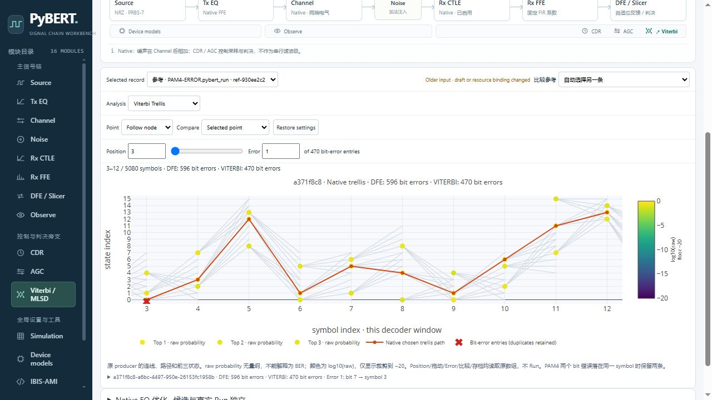

# #9 Native Viterbi / MLSD

从 `3807bd2f54647a491f350cbda7ab61c0752b06f0` / tree `61089b8058acaf08ee2c9b9c643959ded5e21a54` 的独立 managed worktree 实施，仅写 `yx520143-G/PyBERT` fork。PM 对首轮 `d33b58b` 终审发现的两项 P2 已定向修复，当前产品固定于 `e812f4ab1ea150e7e6b65918852195cfbb48f273`；最终交付 HEAD/tree 由 PR 和 PM 交接消息记录。live 合同见 [#9 快照](spec-snapshot.md) 与 [父票快照](parent-snapshot.md)。本票不自行 merge 或关闭 issue。

DFE/CDR 后的可选 Native ISI/MLSD 分支现可启用并设置符号数 Depth，在同一 Run、同一 spawn worker 内调用原 decoder。原 trellis producer 从 `update_results` 原样抽取为 `update_trellis`，桌面 GUI 仍由原路径调用；Web 使用私有 plot-data sink 收集连线、路径和前三状态，不 pickle decoder。`models/viterbi.py` 原文件未变。

新增可选 `decoding` 只读采集：实际 recovered clock times、取样 indices、DFE output samples、恢复相位的 `vod*dfe_out_p` pulse、sigma、decision_scaler、cursor/phase、原始 bits/path/probs/prevs/states/trans。DFE 与 Viterbi 的 `calc_ber` 在各自原调用处分别保存 raw output bits、test/reference 窗口、bit delay 与 auto_corr，不复制最后一次对齐。

Analysis → Viterbi Trellis 显示所选 Run 的原图层。Position 初始 10 symbols，按实际 symbol 数裁界；Error=0 表示未选，其余为 1-based bit-error entries。PAM4 保留 bit index // 2 的重复条目。两 Run 分图比较，各自使用本分析窗口内 symbol index，未做物理时钟/bit delay 对齐。raw state probability 与 log10 色标、显示下限 −20 分列，均不称 BER。切窗、鼠标拖动、Error、比较、保存/打开/reload 不 Run。

原构造默认 Depth=4 保留。状态≤256、state×samples≤2,000,000、dense state²×samples≤25,000,000、Native 时间网格≤2,000,000；不足原生 top-3/采样需求也明确拒绝。只预检完整输入，不减少 N 或 eye window、不切回 DFE-only。N=4 NRZ 的参数/预算检查通过，原完整 PAM4 窗口 N=4 明确超预算；未运行无界/default-depth trellis。

API/YAML 的 `rx_viterbi_fec` 请求明确返回 `unsupported_native_fec`。原 FEC 变量初始化缺陷未修复，不支持标准 FEC 或 AMI 内部解码。Native GUI/CLI/MCP 默认算法保持；CLI version、MCP config/tool 注册做了无仿真兼容检查。

## 冻结与数值

首次计算前提交 `4a6ce7f`；[v1 manifest](fixtures/v1/manifest.json) SHA256 `7161f81e70b38de994e5143907671ba85fbdf2bbcd60122cd3071db5cf507fb5`。7 份完整 JSON/YAML 输入、N=2、固定非零 seed/noise、资源、窗口、预算和逐类型容差均提前登记。95 个顶层字段的文字计数勘误见 [freeze-errata](freeze-errata.md)，原 manifest/request bytes 不改；冻结提交内 YAML 与实际工作文件仅 CRLF/LF 差异已由 PM 核验。执行解释器为 #4 只读 Python 3.13.15，三个项目模块实际均来自 #9 独立工作树；未改共享环境。host 没有 uv，按已授权的现有 runtime 执行，真实路径/依赖在 manifest 中。

| 冻结 case | DFE errors | Viterbi errors | 真实边界 |
| --- | ---: | ---: | --- |
| V-NRZ-ISI | 0 | 0 | Native N2 / L2 |
| V-PAM4-ISI | 0 | 0 | Native N2 / L4 |
| V-DUO-ISI | 74 | 5120 | Native N2 / L3；接入一致，不表示纠错改善 |
| V-NRZ-ERROR | 3 | 0 | 预设噪声未产生 Viterbi 错误，NRZ Viterbi 错误定位缺真实含错证据；没有换 seed 搜索 |
| V-PAM4-ERROR | 596 | 470 | 470 unique symbols，重复 symbol 条目 0 |
| V-DISABLED | 0 | −1 | DFE 当前真实计数保留；Viterbi 未计算 |

[140115](evidence/numerics-20261024-140115/report.json) 与 [140200](evidence/numerics-20261024-140200/report.json) 共 6 direct + 6 adapter 独立实例。整个有效输出 **2871 数组 dtype/shape/C-order bytes exact**；所有计数、bits/indices/path、zero/finite masks、分别捕获的 BER 窗口和归档往返通过。报告保留每项最大差/首错与原容差；没有放宽容差或挑选局部窗口。原生 state-probability 数组实际零值数均为 0；transition matrix 自身的零转移与 state-probability 下溢覆盖分开。受控契约 `[2,3]→[1,1]` 及零概率/log floor 不是原生观测。

## 验证与证据

| 验证 | 证据和适用性 |
| --- | --- |
| 实际源码与原算法 | [来源适用性](source-applicability.md)；[最终审计](evidence/delivery-audit-20261024-143549/report.json) 2899 checks / 0失败、2871 数组 exact，0新增 main/COM。移除只读 capture 并还原 trellis 抽取后，全 `models.bert` AST 与固定基线相同；不是另跑未修改基线的数值声明 |
| decoder/producer 失败与取消 | [lifecycle](evidence/lifecycle-20261024-141052/report.json)：两项明确故障注入均 failed，未发布成功零误码。真实 V-CANCEL 在 Running Viterbi 请求，原检查点稍后 observed、worker join 后才 cancelled；期间拒绝第二 worker，旧成功保留 |
| 归档 | [saved audit](evidence/saved-audit-20261024-141440/report.json) 63 checks / 0失败，0 main；9 类自洽坏副本在发布前拒绝，inventory/旧记录保持。raw2/3/4 的兼容派生样本明确标为受控版本检查，不冒称历史数值重现 |
| Web 回归 | [v2](evidence/contracts-v2.xml) 155 passed；最终预算/色标/Windows/MCP 增量 [v3](evidence/contracts-v3.xml) 18 passed。两组有重叠，不合称唯一测试数。compileall、修改的 JS syntax、git diff --check 通过 |
| Chrome 155.0.8059.85 / 1280×720 | [v1](evidence/chrome-v1/)：实际启用→Depth2→Run，Position/真实鼠标拖动/Error0/1/5070裁界，DFE Responses/Jitter、两 Run 比较、真实下载/打开/reload。3次成功 Run：0/0、596/470、disabled 596/−1；另1次真实键盘 Abort。原 N4预算、非法N、FEC/AMI拒绝及 dirty/旧结果已验 |
| 最终只读 UI | [v2 final view](evidence/chrome-v2/final-view.log)：打开原 archive，复核真正 SVG 色标标题、raw/log 表与 Error1；重新下载原 raw/source manifest bytes exact，0新增 Run |
| 独立审查 | [Standards / Spec](review.md)：初审 Standards 0 / Spec 两项（Windows 来源键、版本降级绕过）均修复，独立 delta 复核 0 新 finding |

## 保存、成本与保留限制

raw schema 升为 5，当前解码扩展 schema=2；完整 `.pybert_run` 继续使用既有 primitive JSON/NPZ 协议。保存实际 axes、producer、原始数组与独立 BER windows；Windows/POSIX source key 兼容。必需身份/数组/轴/窗口、原生错误映射和图层一致性在发布前校验；旧 raw schema 不能携带新 decoding 来绕过校验。旧记录没有字段时显示“该记录未采集”。禁用记录 `n_errs_viterbi=-1`，DFE 不被置零。

PM 复核发现首轮 schema1 的 `symbols_dfe` 是完整 decisions，却错误标注 decoder 窗口；2871数组 exact 仍有效，但不证明元数据正确。新 schema2 保留完整数组、独立 `dfe_symbol_index` 与完整窗口，另存 decoder 使用的尾部映射，并校验 tail × decision_scaler 等于原 `decided_levels`。旧 schema1 原字节读取/保存、trellis 显示明确勘误，不自动修订或用错误窗口对齐。defaults 暖缓存也在返回前拒绝顶层/config/runtime 的 FEC 请求。

本次收口 [88项回归](evidence/pm-p2-regression-v2.xml)、[9份存量定向审计](evidence/metadata-audit-20261024-150741/report.json) 4434 checks / 0失败及[来源/下载封存](evidence/pm-p2-seal.json) 677 checks / 0失败；Chrome v3 实际验证旧勘误、三种暖缓存422且状态不变、schema2衍生打开/保存/reload，均0新Run。衍生件不是新执行证据，原 manifest/raw 未改；两轮红复现和审计脚本前置错误保留。详见 [修订适用性](metadata-correction-v2.md)。本次新增 Main/COM/coopt 均0，累计费用仍为下述21次。

真实 Main 调用 **21 次**：12 次数值 direct/adapter 成功，lifecycle 的 2 次故障注入和 1 次取消，Chrome 的 3 次成功和 1 次取消，另有 2 次误用 `python -m pybert --version` 的 GUI startup。前19次为15成功、2注入失败、2取消；误用入口的两次没有采集完整 raw/数值终态，保留 **unknown**，不计成功或资格。2注入失败不是原生真实算法缺陷。数值 COM **0**、coopt **0**。各次 elapsed/退出与数值批次采样的 peak working set 在原报告；lifecycle/Chrome/两次误入口的峰值和误入口的数值 elapsed 未采集，保持 unknown。常规归一化 worker 与 mock 回归不计作 Main。

`python -m pybert` 是 GUI 入口，会先构造默认 `PyBERT()` 并仿真，再尝试 UI；`--version` 没有被该入口解析。两次均以 null toolkit 的 GUI 异常退出，日志与边界见 [CLI误入口记录](evidence/cli-misentry.md)。默认 `rx_use_viterbi=False`、`enable_com=False` 的原源码可核查；这不是运行默认 trellis 或默认 COM。正确项目入口 `from pybert.cli import cli; cli()` 的 version 检查已通过（[日志](evidence/cli-version-corrected-v2.log)，0 Main）。原 [static-final](evidence/static-final.json) 的 CLI exit=1 保留，修正记录见 [v2](evidence/static-corrected-v2.json)。

保留先前 88/1 回归失败及 red 复现、Windows 来源校验导致的 lifecycle 前置失败（0 Main）、脚本命令引号/文件选择/过早终态断言/预算断言等原日志。修复仅接续已完成 Run；这些失败没有删除或改记通过。首轮 disabled 执行期间 UI 变化及事后重建 index 有独立来源补存说明。最初色标 title 的 Plotly 3.7 字符串兼容问题已在最终 SVG 实测修复；旧截图不作为最终标题证据。

ignored raw/archive 保留在本 worktree 的 `evidence/**/local/` 与 `output/playwright/issue9/`，不加入 PR、不清理。证据服务只保留缓存淘汰原件，不改数值 worker；产品仍为两成功临时缓存。8776/8777/8778 服务及本票 Chrome 会话在交付前停止。主 checkout 仍是 `b9c56fe` 及原 `docs/research/`、`source/` untracked；前任工作区/失败/费用不动。

#4 默认 COM 139756144 外层继续 **OPEN / BLOCKED_BUDGET / NOT_EXECUTED**，本票不跑 full sweep、FOM 或替代配置。#16 外部 S8P/S12P 开发后补验、TIME/CTLE File/非零 impulse_length/package+FEXT 与历史 PAM4 errors 等原边界继续保留。本票只交付有界原生接入一致性，不称纠错性能、COM/标准或硬件资格。
