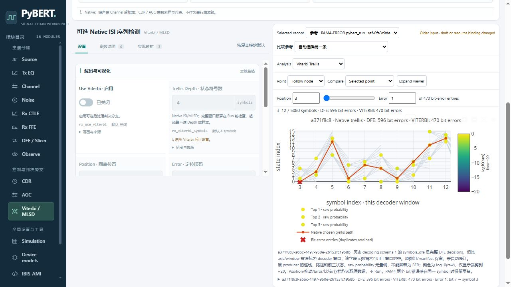

# PM 两项 P2 的修订适用性

PM 对固定 `d33b58b6bdf73570dbb81b62f451be636c1c047c` 的 fresh 终审指出两项 P2（PR19 review 5637253982）。首轮独立审查的0新增结论不能代替此次缺陷修复。产品由 `1b711cf`、`e812f4ab1ea150e7e6b65918852195cfbb48f273` 修复；本轮不新增 Main/COM/coopt，累计 Main21及两次 CLI UNKNOWN 保持。

## 暖 defaults 缓存

`Tasks.normalize` 的提前返回绕过原 `start` / `config.normalize` 拒绝，顶层 FEC 请求被静默丢弃。现在缓存前先拒绝顶层/config字段，缓存分支复用 `config.extensions()` 校验 runtime；独立复核发现 runtime 同类残余后也已红灯复现并闭环。

[初始红灯](evidence/pm-p2-red-v1.log) 两项失败、[runtime红灯](evidence/pm-p2-runtime-red-v1.log) 一项失败均保留。[88项回归](evidence/pm-p2-regression-v2.xml) 覆盖真实HTTP先初始化defaults，再提交顶层/config/runtime三种FEC请求，均422；禁止新Process构造、原成功目录及记录索引不变。这里使用受控旧成功字节，实际原archive保留由存量审计验证。Chrome v3也在实际初始化后检查三种请求、全部state不变，0 Run。

## 完整 DFE decisions 与 decoder 尾部

原 native `dbg_dict_viterbi["symbols_dfe"]` 保存完整 `decisions`，而 `decided_levels` 来自 `decisions[-len(sig_samps):] * decision_scaler`。首轮Web把所有debug数组共用decoder窗口，造成PAM4完整7500项被标成[0,5080)，axis为null。原数组本身未被裁剪；既有2871数组 exact 仍成立，旧元数据错误单独保留。

新 decoding schema2：

- `symbols_dfe` 原数组不变；`dfe_symbol_index` 为完整返回顺序的0-based序号，窗口为[0,完整数量)。该序号不冒称完整恢复时钟物理轴。
- `decoding.dfe_decisions` 记录完整数量、decoder尾部起止、decoder axis ID和原selection。PAM4本批为[2420,7500) → decoder [0,5080)。这忠实记录原native尾部选取，不声称它和另行选择的sample clocks一一物理对齐。
- 发布与打开共同校验完整轴/窗口/clock basis、tail×scaler与原 `decided_levels` 精确一致；仅改版本为1不能绕过schema2新增字段检查。
- 旧schema1继续按原manifest/raw字节打开、保存。其trellis明确显示 `symbols_dfe` 原axis/window有误、不可用于窗口对齐；不自动改写旧元数据，不把旧记录伪装为schema2。该兼容路径仍校验原数组与尾部scaler关系。

[metadata-audit-20261024-150741](evidence/metadata-audit-20261024-150741/report.json) 共9份存量记录（6份数值adapter、3份Chrome成功），4434 checks / 0失败，0 Main/COM。审计从原primitive capture重走新的收集/原trellis producer，未调用decoder.decode或仿真；每个原数组dtype/shape/bytes不变，仅启用记录增加完整轴。修订manifest具有 `metadata_derivation`，保存原manifest/raw SHA与修订adapter源SHA，原执行source表保留。衍生件明确不是新Run或最终代码数值重跑。逐HTTP打开、重新保存的source/raw精确一致；每份启用档的axis/window/mapping/schema四类自洽坏副本均拒绝且旧reference inventory保留，历史文件逐字节不变。

审计前两次尝试分别因Windows source-key查找、误把HTTP201断言为200停止；无Main、没有完整报告，source与verifier及console-v1/v2保留，不计通过。成功报告Git HEAD字段是1b711cf，当时e812f4a的Tasks修复已在磁盘；实际35份source bytes封存并由[最终seal](evidence/pm-p2-seal.json)核对与e812f4a当前产品逐字节相同，不能仅以报告HEAD代替actual source。

## Chrome 与最终封存

Chrome155 / 1280×720，8778服务的唯一worker请求是defaults归一化，0Main。旧PAM4-ERROR真实下载档打开、勘误可见、三种FEC422、state不变、重存raw/source exact；schema2衍生档打开、完整DFE7500及尾部映射核对、保存/reload无Run。日志在[chrome-v3](evidence/chrome-v3/)，最终677项只读seal全部通过；原始archive与新衍生archive分别比较，不将二者互称执行原件。初次CLI引号及API相对URL错误保留，不计通过。favicon404是既有行为。

服务PID58356/3816在身份核对后停止，本票Chrome会话关闭；8776/8777/8778无Listen。旧失败、费用、原始数组/manifest和ignored衍生archive均不清理。原NRZ/Duo/重复symbol/零概率缺口、#4默认COM和#16未执行边界不变。
