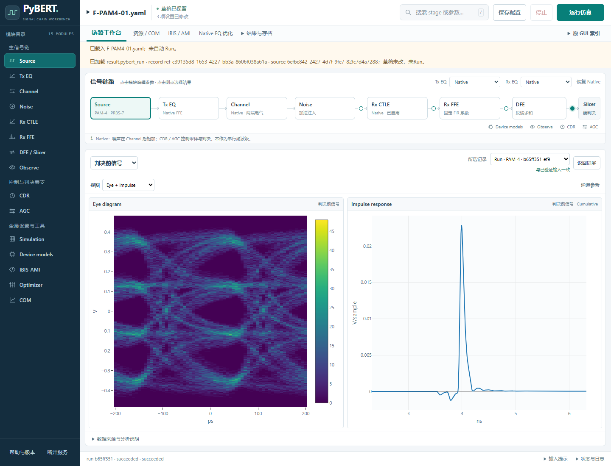
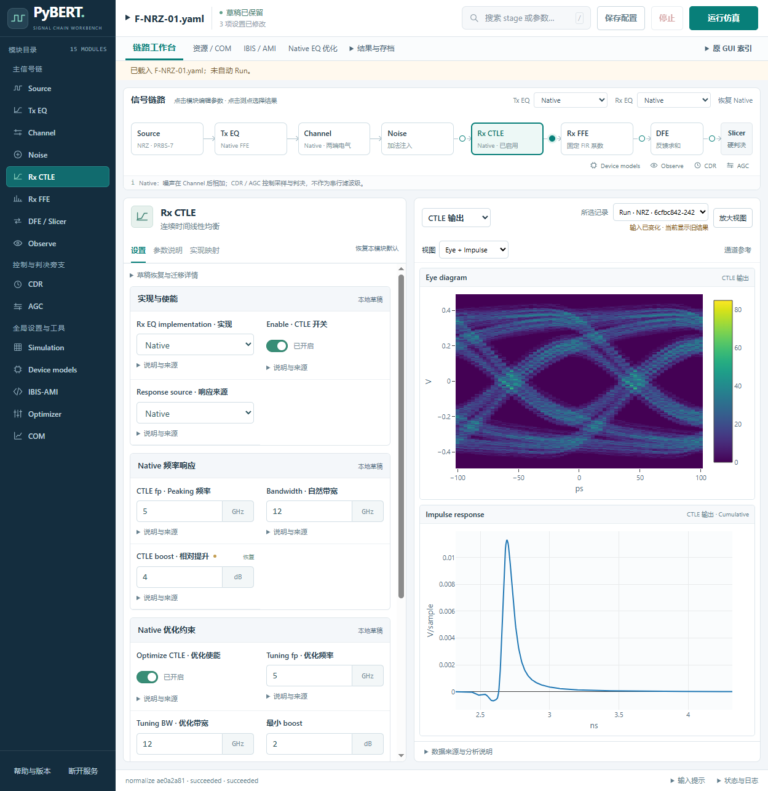

# WebUI 真实 Run 与视图验收

执行日期：2026-10-26～27（Asia/Shanghai）。沿用用户确认的“修改参数后手动点击 Run”。

PR #35 的 `16ee4f406146a2d92fd1190b65913e24a8730b8b` 已具备完整计算与绘图链路。本次在隔离服务中完成 Native NRZ / PAM4 的真实运行验收，没有发现需要补写接口或修改算法的接线缺口。产品源码、依赖和子模块均未改动；新增内容是前端状态回归测试、验收脚本与证据。

本机验收服务：[http://127.0.0.1:8798](http://127.0.0.1:8798)。原 `8797` 服务未被替换；其两份历史 reference 已另存到本目录的 `local/existing-references/`。服务中的临时结果仍遵循最近两次成功 Run 的缓存限制；A 已通过完整存档重开为 reference。

## 真实执行结果

三次 Web Run 均由 Chrome 中的“运行仿真”按钮提交，任务最终 `succeeded`，worker 已退出且 exit code 为 0。另执行两次直接原生调用，共 **3 次 Web Main + 2 次直接原生 Main**，没有追加仿真。

| 用例 | 输入 | 原始数组 | 直接原生对照 | Main / 完整任务耗时 |
| --- | --- | ---: | --- | --- |
| A | `F-NRZ-01.yaml`，CTLE boost 1.7 dB | 444 | 444 / 444：dtype、shape、bytes 完全一致 | 2.416 / 9.700 s |
| B | A 仅改 `peak_mag` 为 4.0 dB | 444 | 按计划不重复直接 Main；验证单参数作用范围 | 2.413 / 9.818 s |
| C | `F-PAM4-01.yaml` | 445 | 445 / 445：dtype、shape、bytes 完全一致 | 1.425 / 13.373 s |

输入均为 15000 bits、32 samples/UI、EyeBits 10160、seed 1；Native Tx/Rx、COM 关闭、Viterbi 关闭。直接对照使用 fresh `PyBERT(run_simulation=False, gui=False)`，原生 YAML 加载、原生 Main 和既有结果采集；没有重写参考计算。A/C 的 summary（排除性能计时字段）及分析 window 也完全一致。直接对照全流程分别耗时 10.050 / 5.274 s；未测量峰值内存。

完整身份与计数见 [acceptance-summary.json](acceptance-summary.json)、[A 对照](A-direct-comparison.json)、[C 对照](C-direct-comparison.json)。服务访问日志也确认只有 [3 次 POST /api/runs](http-run-posts.txt)。

## 页面与数据核对

保留了 [29 项浏览器检查](browser-checks.json)。检查读取真实 Plotly 对象的 `x/y/z` 数组，与该浏览器实际收到的绘图 HTTP 响应比较，同时核对记录身份和轴单位；不以截图相似替代数值检查。

- NRZ / PAM4 的通道参考、接收端输入、CTLE、FFE、判决前信号双图均显示成功。Impulse 保持 ns / V/sample，Eye 保持 ps / V；PAM4 的四电平来自原始激励。
- Source、Noise、Jitter distribution / spectrum / bathtub、DFE adaptation、CDR adaptation / histogram / spectrum 使用所选记录的数据；四信号 Waveform / Eye 和两次 Run 的 CTLE response 比较通过。
- A→B 只有 `peak_mag` 在 requested / effective input 中变化。Run 前仍显示 A 的原图并提示输入已变化；Run 后自动选择 B，输入 hash 与 identity hash 均变化。Source、Channel、Rx input 逐字节不变，CTLE 及下游 FFE / DFE 变化；444 个数组中有 155 个变化。见 [参数变化报告](A-B-parameter-change.json)。
- 通过页面重开 A 的 `.pybert_run` 后，reference ID 与原 run ID 分开保存，导出 NPZ bytes 与原文件完全一致；当前 PAM4 草稿、修订号均未改变，未新增 Run。见 [归档结果](archive-roundtrip.json) 与总报告中的 `archive`。
- 切换已有记录、切换测点及放大视图均未追加 Main。图形含义沿用原生定义：DFE impulse 是最终权重等效 FIR，通道双图使用 clean eye，CDR spectrum 保留 legacy log10 ratio。





## 回归与来源

[测试记录](test-results.json)：前端 **9 项通过**（原 4 项及新增 5 项），分析 / 归档 **54 项通过**。新增测试覆盖无记录、测点迟到响应、记录与绘图迟到响应、单张 Eye 不可用、当前任务失败时保留已有成功双图。后两类错误场景使用测试替身；这不表示本次又运行了失败仿真。分析 / 归档测试使用保存或合成数组及 `no_engine_terminal`，没有调用真实 Main。

[独立审查](review.md)：Standards 0 findings；Spec 0 个可行动发现，同时保留 A/B 浏览器网络对象未完整落盘的历史限制。审查者直接重读已保存 NPZ 复核了 A/C 的精确比较，未追加 Main。

执行前冻结并在后续调用前复核了 **137 个源码 / 输入文件 hash**。PyBERT 来自本隔离 checkout；PyAMI / PyChOpMarg 从既有干净 checkout 按 Git pin 加载，分别为 `dfae46033f490c9d19f2684454b6fe9bd90d9a72` / `ca905e793fcf6330929471317ca32e7611578e5d`。解释器为既有资源验收环境的 Python 3.13.15。实际模块路径、hash 和依赖版本见 [freeze.json](freeze.json)、[server-provenance.json](server-provenance.json)；每个 Run 的 worker 记录保存在对应 `local/A`、`local/B`、`local/C` 中。

## 复核与保留文件

工作目录：`C:/Users/yx/.codex/worktrees/pybert-webui-real-views/serial-bus-simulator`，分支 `codex/webui-real-views`。以下命令只读取已有结果、重新检查证据，**不运行 Main**：

```powershell
Set-Location 'C:/Users/yx/.codex/worktrees/pybert-webui-real-views/serial-bus-simulator'
python -m uv run --no-project --python 'C:/Users/yx/.codex/worktrees/pybert-issue4-resources/serial-bus-simulator/.venv/Scripts/python.exe' python -B 'docs/webui/real-view-integration-20261026/verify_saved.py'
```

若需要重新启动已停止的验收服务，在同一目录和环境下将最后的脚本改为 `verify_native.py serve`。该验收脚本有固定的本机依赖路径和源码 hash，不能作为其他版本的通用启动器。服务重启后可通过“结果与存档 → 打开结果 / 加入比较”恢复以下文件；不会自动重算。

| 保留位置 | 内容 |
| --- | --- |
| `local/A/`、`local/B/`、`local/C/` | manifest、完整 NPZ、`.pybert_run`、replay input、服务端请求、任务与 worker 来源 |
| `local/direct-A/`、`local/direct-C/` | 两次直接原生调用的完整输出 |
| `local/final-browser-audit.json` | C 阶段完整被动观察记录：1 次 Run POST、16 份绘图响应、10 项视图检查；[大小与 hash](browser-final-capture.json) |
| `local/existing-references/` | 原服务两份 reference 的备份 |
| `output/playwright/real-views/`（仓库根目录下） | 浏览器快照、截图、逐视图核对输出、服务日志、C 的实际浏览器 POST |
| `verify_native.py` | 固定源码、服务启动、结果保存、直接原生对照；`direct` 会运行 Main，本轮已执行完毕 |
| `observe_browser.js` / `check_browser.js` | Playwright CLI 的被动网络观察与实际绘图核对 |
| `verify_saved.py` | 已保存证据复核与报告汇总，无 Main |

大型原始数组与存档保留在本机忽略目录中，未加入 Git；JSON 报告和上述两张原始截图用于审阅。其他机器仅检出仓库并不能获得这些本机原始附件。

## 限制与异常记录

A/B 完成、两次 Run 的 CTLE 比较通过后，原浏览器页面关闭，导致尚未导出的浏览器网络观察内存丢失；后续自动选择命令因失去页面而报错。已保留这些错误输出，没有将失败操作计为通过。A/B 的服务端实际接收请求（另带资源冻结字段）、任务身份、完整结果、截图和已落盘的逐视图检查仍在；A/B 的完整浏览器侧网络对象未保留。随后使用独立 headless Chrome 完成 C、记录切换和重开验证；C 的浏览器 POST 单独保存为 [C-browser-post.json](C-browser-post.json)。没有重跑 A/B 或扩大 Main 预算。

浏览器控制台出现 favicon 404；直接原生调用保留了 jitter 拟合 covariance 的 `OptimizeWarning`，分析 / 归档测试保留了 35 条第三方弃用警告。它们未被改写为数值资格通过，也未因警告放宽数组比较要求。原 [实施计划](implementation-plan.md) 与其 [只读现场记录](runtime-readonly.json) 保留为执行前资料。

结论仅适用于上述固定 Native 场景和版本的计算—显示链路。真实 AMI 仍暂缓，COM 大搜索、优化器、Viterbi、外部通道的新验收均未执行；本次不产生硬件或标准资格结论。PR #35 及其基分支的最终合并仍是独立集成事项。
