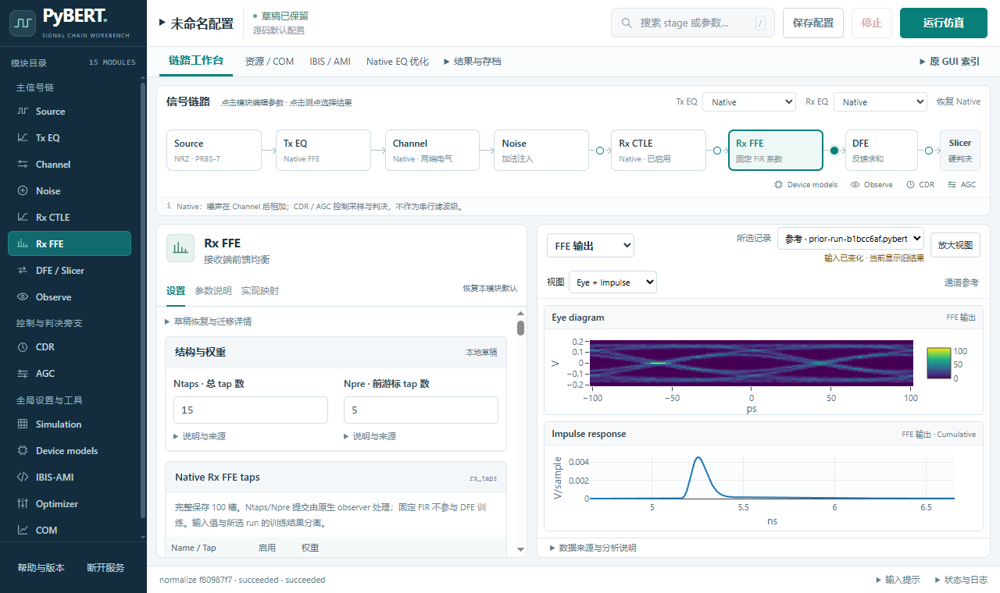

# WebUI 同屏调试与测点导航

本交付将参数编辑、信号链和 Eye / Impulse 放在同一工作区，采用用户确认的紧凑测点方案。Slicer 保留在 DFE 后方，点击仍打开原有 DFE / Slicer 设置；测点悬停只显示信号名称。

基线为已经推送的 `codex/restore-ami-single-init`，提交 `108b4d5d4fa7f8fad69dbc0d263608011f98b0cf`。本次 WebUI 分支基于该版本，PR 也以该分支为目标；基线相对 `master` 尚未合入的 AMI 修改不属于本次 WebUI 差异。

## 行为与范围

- 参数模块与观察信号分别选择。四个主链测点和结果标题双向联动；模块切换保留已选观察信号，Source、Noise、Channel 的专用入口按其原有数据打开对应分析。
- 通道参考保留独立入口；结果概览、Jitter 汇总、Run 输入比较归入“结果与存档”。DFE/CDR 专用视图只在判决前信号提供，其他测点自动回到可用视图。
- 收起字段来源说明和当前模式不适用的控件；按已确认范围暂缓展示 Viterbi 界面，已有配置与后端能力保留。
- 修复连续修改调制方式时后台校验锁住编辑器、过期响应覆盖新草稿的问题。原生校验 API 保持，显式保存和运行仍要求已验证输入。
- Python、数值计算、依赖、子模块与原生 GUI 均未修改；本次验收没有启动新仿真。

产品文件仅为以下五个静态文件：

- `src/pybert/web/static/app.js`
- `src/pybert/web/static/index.html`
- `src/pybert/web/static/layout.js`
- `src/pybert/web/static/workbench.js`
- `src/pybert/web/static/workbench.css`

另外提交 `tests/web_workbench.test.cjs`、根目录 `design-qa.md`，以及本目录的 README 和下表六份附件，共 14 个文件。

## 验证

提交前执行 `uv run --no-project node --test tests/web_workbench.test.cjs`，4 项测试全部通过：过期校验成功、过期校验失败、当前错误保留草稿、显式保存锁定输入。三个 JavaScript 文件通过 `node --check`；文本通过 UTF-8 without BOM 和 diff 空白检查。

实际 Chrome 验证覆盖测点选择、键盘操作、Slicer 设置、上下文菜单、原 GUI 分析快捷入口和四信号比较。1280×760、2545×1223、2560×1440 均无页面溢出，Slicer 与两张图完整可见，控制台无错误或警告。浏览器验收是交互与显示检查，不增加数值资格结论。

| 附件 | 内容 |
| --- | --- |
| [final-1280x760.png](final-1280x760.png) | 紧凑视口；Rx FFE 参数、FFE 输出双图、Slicer |
| [implemented-2560x1440.png](implemented-2560x1440.png) | 宽屏；Channel 参数、接收端输入双图、Slicer |
| [interaction-checks.json](interaction-checks.json) | 测点、参数模块、Slicer、菜单、接收机专用视图和草稿保留 |
| [legacy-comparison-checks.json](legacy-comparison-checks.json) | 原 GUI 快捷入口及原有四信号比较 |
| [responsive-checks.json](responsive-checks.json) | 三个视口、图表边界、完整信号链和短提示范围 |
| [service-checks.json](service-checks.json) | 0 条新 Run、2 条 reference、无活动任务；存档标识和 hash 保持 |

以上六份附件由本轮实际验收输出复制，复制后核对 SHA-256 一致。PNG 保持原始字节，JSON 按仓库文本规则保存换行；检查内容没有修改，没有重绘截图或补算曲线。截图中的“输入已变化”准确表示当前草稿与所选旧结果不同。

[完整 QA 记录](../../../design-qa.md)保留各轮设计与修复过程，其中历史本机路径只在原工作环境可访问；GitHub 上的最终验收入口以上表附件为准。

final result: passed
